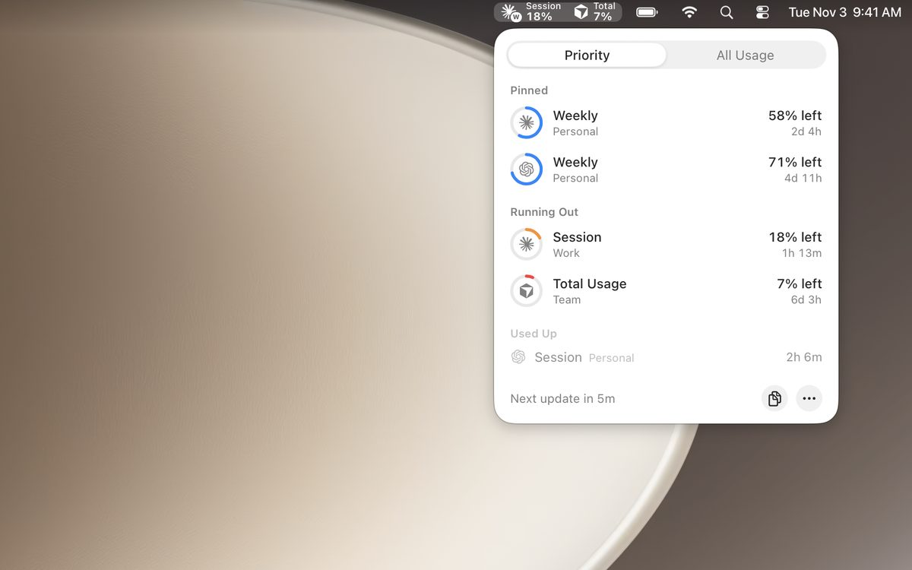
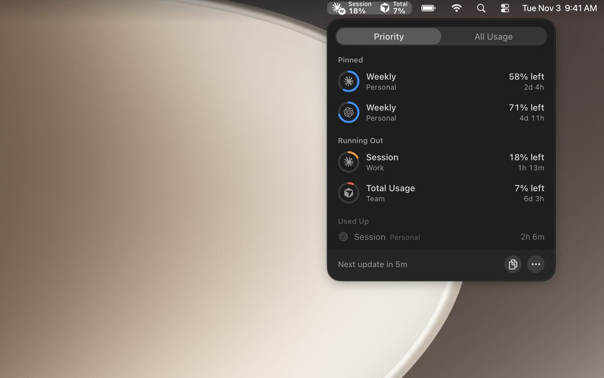
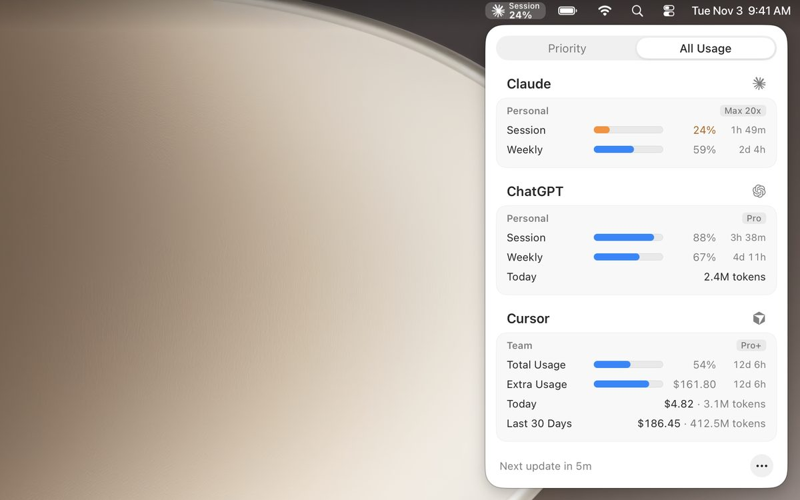
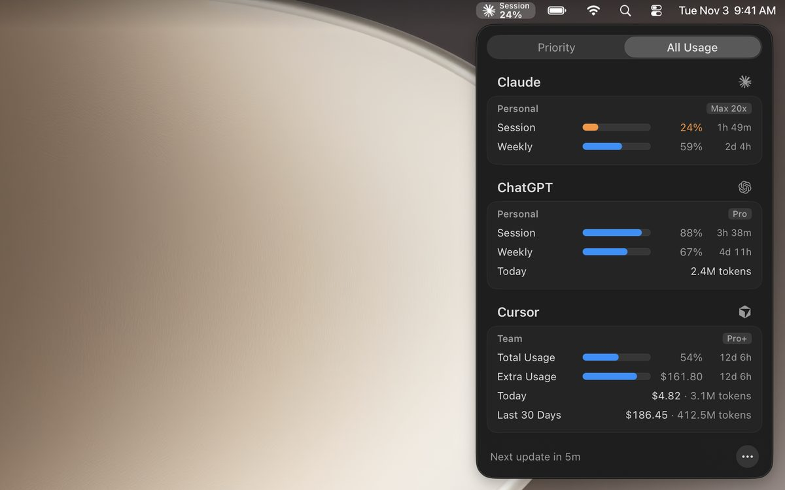

# OpenUsage

Track your AI coding subscriptions from the macOS menu bar.

OpenUsage shows how much of each AI plan you've used: session and weekly limits, credits, and
balances, all in one panel. The limits closest to running out sit right in the menu bar.

| | Light | Dark |
| --- | --- | --- |
| **Priority** |  |  |
| **All Usage** |  |  |

## Installation

- **Homebrew:**

  ```sh
  brew install --cask openusage
  ```

- **Direct download:** grab the latest universal DMG from the
  [releases page](https://github.com/robinebers/openusage/releases/latest), open it, and drag
  OpenUsage to your Applications folder.

The app updates itself with signed, notarized [Sparkle](docs/updates.md) updates. Requires macOS 15
(Sequoia) or later, on Apple Silicon or Intel.

## Supported Providers

- **[Claude](docs/providers.md#claude)**: session, weekly, model limits, extra usage (Enterprise spend), rate-limit resets
- **[ChatGPT](docs/providers.md#chatgpt)**: session, weekly, Spark, extra usage, credit limit, rate-limit resets, daily tokens
- **[Cursor](docs/providers.md#cursor)**: total usage, model usage, extra usage, requests, credits, daily spend and tokens
- **[Antigravity](docs/providers.md#antigravity)**: Gemini and Claude quotas
- **[Copilot](docs/providers.md#copilot)**: credits, extra usage, chat, completions, organization billing, GitHub Enterprise on GHE.com
- **[Devin](docs/providers.md#devin)**: daily and weekly quota, extra usage
- **[Grok](docs/providers.md#grok)**: weekly limit, extra usage
- **[Muse Code](docs/providers.md#muse-code)**: session, weekly
- **[Ollama](docs/providers.md#ollama)**: session, weekly, monthly, extra usage, daily usage and tokens
- **[OpenCode](docs/providers.md#opencode)**: session, weekly, monthly
- **[OpenRouter](docs/providers.md#openrouter)**: balance, spend, key limit, budget
- **[Z.ai](docs/providers.md#zai)**: session, weekly, web searches, rate-limit resets
- **[CLIProxyAPI hubs](docs/cliproxyapi.md)**: every Claude, ChatGPT, Antigravity, Devin, and Grok login on
  a [CLIProxyAPI](https://github.com/router-for-me/CLIProxyAPI) server

Add your accounts from the app's Accounts screen. OpenUsage never reads other tools' credentials,
files, or logs. See [Accounts](docs/accounts.md). Coming from 0.7.x? See
[Upgrading from 0.7.x](docs/settings.md#upgrading-from-07x).

## Features

- **Menu bar.** The limits closest to running out, at a glance.
- **Priority.** What's running low, what's used up, and which accounts need you.
- **All Usage.** Every account and limit in one place, with resets, your pace, and an optional mark
  where an even pace would be.
- **Your layout.** Pin the metrics you care about, hide the rest with a right-click, and drag
  everything into your order.
- **Rate-limit resets.** See and spend Claude and ChatGPT resets.
- **Share.** Copy a picture of your usage to the clipboard.
- **Notifications.** A heads-up before a limit runs out, or before a weekly limit resets with most of
  it unused.
- **Priority limits.** Choose how much left turns a limit orange or red, see limits you're burning
  through too fast while they still have plenty left, and see limits about to reset mostly unused.
- **Global shortcut.** Toggle the panel from anywhere.
- **[Command line](docs/cli.md).** Your usage as JSON, for scripts and agents.
- **[Automatic updates](docs/updates.md).** Signed, notarized updates, with an optional beta channel.
- **[Proxy support](docs/proxy.md).** Route provider requests through a SOCKS5, HTTP, or HTTPS proxy.

## Documentation

How everything works, in [docs/](docs/README.md):

- [Dashboard](docs/dashboard.md)
- [Accounts](docs/accounts.md) and [CLIProxyAPI hubs](docs/cliproxyapi.md)
- [Providers](docs/providers.md)
- [Menu bar](docs/menu-bar.md)
- [Settings](docs/settings.md)
- [Refreshing](docs/refreshing.md)
- [Command line](docs/cli.md)
- [Updates](docs/updates.md)
- [Proxy](docs/proxy.md)
- [Privacy](docs/privacy.md), including optional daily provider account counts

## License

[MIT](LICENSE)

---

<details>
<summary><strong>Build from source</strong></summary>

```sh
swift build                 # debug build
script/test_quiet.sh        # run the tests without them taking the keyboard or the screen
./script/build_and_run.sh   # build and launch the dev app from dist/
```

`script/test_quiet.sh` takes `swift test` arguments such as `--filter`. The dev app has its own
bundle identifier, so it runs beside an installed OpenUsage. See [debugging](docs/debugging.md).

To learn the code, read the [architecture overview](docs/architecture.md),
[adding a provider](docs/adding-a-provider.md), and [AGENTS.md](AGENTS.md).

</details>

<details>
<summary><strong>Releasing</strong></summary>

Push a `v*` tag on `main` to build, sign, notarize, and publish a release:

- A plain tag (`v0.8.0`) ships to everyone.
- A pre-release tag (`v0.8.0-beta.1`) ships to the beta channel.

The pipeline is [release.yml](.github/workflows/release.yml), and the steps are in the
`release-swift` skill.

### Release setup (one-time)

The workflow needs these repository secrets (Settings → Secrets and variables → Actions):

| Secret                       | What it is                                                            |
| ---------------------------- | --------------------------------------------------------------------- |
| `APPLE_CERTIFICATE`          | base64 of your Developer ID Application `.p12`                        |
| `APPLE_CERTIFICATE_PASSWORD` | the password set when exporting that `.p12`                           |
| `APPLE_ID`                   | the Apple ID email used for notarization                              |
| `APPLE_PASSWORD`             | an app-specific password for that Apple ID                            |
| `APPLE_TEAM_ID`              | your Apple Developer team ID                                          |
| `SPARKLE_PUBLIC_KEY`         | base64 EdDSA public key, baked into the build as `SUPublicEDKey`      |
| `SPARKLE_PRIVATE_KEY`        | base64 EdDSA private key used to sign the DMG                         |
| `POSTHOG_CLI_API_KEY`        | PostHog personal API key used to upload dSYMs for crash symbolication |
| `POSTHOG_CLI_PROJECT_ID`     | numeric PostHog project ID the dSYMs upload to                        |

- Export the Developer ID Application certificate, with its private key, from Keychain Access as a
  `.p12`. Then run `base64 -i DeveloperID.p12 | pbcopy`.
- Create the app-specific password at appleid.apple.com → Sign-In and Security → App-Specific
  Passwords.
- Generate the Sparkle key pair once with Sparkle's `generate_keys` tool. If the two keys don't match,
  signing is silently skipped.
- The `POSTHOG_CLI_*` secrets only upload dSYMs so crash reports symbolicate. Without
  `POSTHOG_CLI_API_KEY`, the workflow skips the upload with a warning and the release still ships.
  The key comes from PostHog → Settings → Personal API keys, and the project ID is the number in your
  project URL.
- Keep the repository public, because Sparkle fetches the DMG and appcast anonymously. After the first
  release, confirm that Settings → Pages → Source is GitHub Actions; `deploy-pages.yml` publishes `gh-pages`.

</details>

<details>
<summary><strong>Contributing</strong></summary>

Pull requests are issue-first:

1. Comment on an issue.
2. Wait for a maintainer to add the `approved` label and assign it to you.
3. Open your PR with `Fixes #123`.

Automation closes external PRs that skip this. Read [CONTRIBUTING.md](CONTRIBUTING.md) first. Report
security issues privately per [SECURITY.md](SECURITY.md). The OpenUsage name and logo are covered by
the [trademark policy](TRADEMARK.md).

</details>
